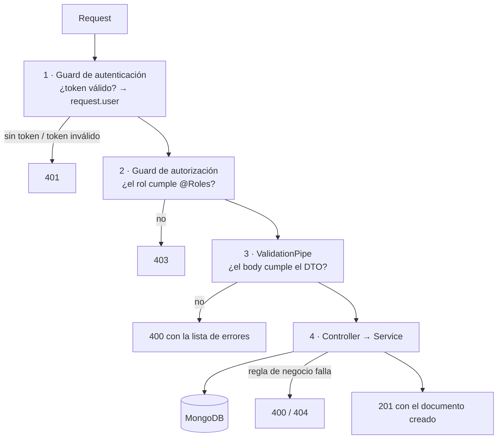

# Arquitectura

Cómo está organizado el proyecto, qué hace cada pieza y por qué se hizo así.

## Estructura de carpetas

```
src/
├── main.ts                     Arranque de la app
├── app.module.ts               Módulo raíz: configuración, Mongo y los módulos de negocio
├── app.controller.ts           GET /api → "Hello World!" (público, sirve para ver si la API responde)
│
├── conf/
│   ├── config.yaml             Valores de configuración (puerto, Mongo, colecciones, JWT)
│   └── config.ts               Lee el YAML y se lo entrega a ConfigModule
│
├── common/                     Código que usan todos los módulos
│   ├── dto/pagination.dto.ts           ?search, ?limit, ?offset
│   ├── filters/mongoose-exception.filter.ts  Errores del esquema de Mongo → 400 en vez de 500
│   ├── pipes/parse-mongo-id.pipe.ts    Rechaza ids que no son de Mongo (400)
│   ├── transforms/to-boolean.transform.ts      "true"/"false" de la URL → boolean
│   ├── transforms/normalize-spaces.transform.ts "  a   b " → "a b"
│   ├── utils/mongo.utils.ts            Búsqueda sin tildes, duplicados, paginación
│   ├── utils/pendientes.utils.ts       Qué datos le faltan a un registro (campo "pendientes")
│   └── utils/texto.utils.ts            capitalizar("josé muñoz") → "José Muñoz"
│
├── auth/                       Usuarios, login y permisos → ver seguridad.md
│
├── iglesias/                   Directorio de iglesias
├── actividades/                Calendario de actividades
├── noticias/                   Noticias y comunicados
├── mensajes/                   Formulario de contacto del sitio
├── historial/                  Quién cambió qué ("Actividad reciente"); sin rutas propias
├── correo/                     Envío de correos (@nestjs/mail) → ver correo.md
└── resumen/                    Pantalla Resumen del panel: tarjetas, Por hacer, accesos, actividad, avance
```

Cada módulo de negocio (`iglesias`, `actividades`, `noticias`) tiene la misma forma:

| Archivo | Qué hace |
|---|---|
| `*.module.ts` | Registra el modelo de Mongo, el controller y el servicio |
| `*.controller.ts` | Define las rutas y **quién puede usarlas** (decoradores de rol) |
| `*.service.ts` | La lógica: consultas a Mongo, reglas de negocio, errores |
| `entities/*.entity.ts` | El esquema de Mongo: qué campos se guardan y cómo |
| `dto/create-*.dto.ts` | Qué se acepta al crear (validación de entrada) |
| `dto/update-*.dto.ts` | Lo mismo pero todo opcional, más `isActive` |
| `dto/find-*.dto.ts` | Filtros del listado (`?distrito=`, `?desde=`...) |

**Por qué esta separación:** el controller solo decide *quién entra y qué recibe*; el servicio decide *qué pasa*. Así las reglas de negocio se pueden probar sin levantar un servidor (ver `iglesias.service.spec.ts`), y los permisos se leen de un vistazo en el controller.

## El camino de un request

Ejemplo: el panel crea una actividad con `POST /api/actividades`.



1. **Autenticación** (`@nestjs/authentication`, global): lee `Authorization: Bearer <token>`, verifica la firma y la expiración, y carga el usuario desde Mongo. Las rutas `@Public()` se saltan este paso.
2. **Autorización** (`@nestjs/authorization`, global): ejecuta la regla de `@Roles(...)`. Si la ruta no declara ninguna regla, **la rechaza**: así una ruta nueva nunca queda abierta por olvido.
3. **Validación** (`ValidationPipe` en `main.ts`): compara el body/query con el DTO. Con `whitelist` + `forbidNonWhitelisted`, cualquier campo que no esté en el DTO devuelve 400. Esto evita, por ejemplo, que alguien mande `"roles": ["ADMIN"]` al registrarse o `"autor"` en una noticia.
4. **Servicio**: aplica reglas que el DTO no puede ver solo (fechas coherentes, coordenadas en par, duplicados) y habla con Mongo.

## Arranque: `main.ts`

| Línea | Por qué |
|---|---|
| `setGlobalPrefix('api')` | Todas las rutas empiezan con `/api`, así se distinguen de las del front si comparten dominio |
| `enableCors(...)` | Permite que el sitio y el panel (en otro dominio/puerto) llamen a la API. Los dominios salen de `CORS_ORIGINS`; sin definir, acepta todos |
| `enableShutdownHooks()` | Al apagar, el módulo de correo espera los envíos en curso y cierra las conexiones SMTP |
| `ValidationPipe({ whitelist, forbidNonWhitelisted })` | Valida todo lo que entra y rechaza campos desconocidos |
| `useGlobalFilters(new MongooseExceptionFilter(...))` | Lo que rechaza el esquema de Mongo (un obligatorio enviado como `null`) responde 400 y no 500 |
| `PORT` o `configService.get('port')` | La variable `PORT` (la que fijan los hostings) o, si no, `port` de `config.yaml` (3500) |

## Configuración: `conf/` y `.env`

Hay dos fuentes, y cada una tiene su propósito:

- **`config.yaml`**: valores que no son secretos y pueden ir en git (puerto, nombres de colecciones, URL de Mongo local). Se copia a `dist/` al compilar (lo indica `nest-cli.json`).
- **`.env`**: secretos y lo que cambia por ambiente (`JWT_SECRET`, `STAGE`, `URI`, `MAIL_USER`, `MAIL_PASSWORD`, `CORS_ORIGINS`). No va en git.

La conexión a Mongo (`app.module.ts`) elige según `STAGE`:
- `dev` → `mongo.url` y `mongo.dbName` de `config.yaml`
- `production` → variables `URI` y `DBNAME`
- cualquier otro valor → la app no arranca y dice por qué (antes intentaba conectarse a una URI vacía)

Al conectar se muestra la URI en consola **con la clave oculta**.

Cada módulo toma el nombre de su colección de `config.yaml` (`collectionNameIglesia`, etc.). **Por qué:** permite apuntar a colecciones distintas sin tocar código (por ejemplo, para pruebas).

## Decisiones de diseño comunes

### Borrado lógico (`isActive`)
`DELETE` nunca borra el documento: lo marca `isActive: false`.
- **Por qué:** un borrado por error se deshace con `PATCH { "isActive": true }`, y se conserva el historial (una actividad pasada, una iglesia que cerró).
- Los visitantes nunca ven lo desactivado; el panel puede listarlo con `?isActive=false` para reactivarlo.

### Listados paginados
Todos los `GET` de lista responden igual:

```json
{ "total": 42, "limit": 20, "offset": 0, "data": [ ... ] }
```

- `limit` por defecto 20, máximo 100. **Por qué el máximo:** que nadie pueda pedir toda la base en un solo request.
- `total` permite al front calcular cuántas páginas hay.

### Búsqueda sin tildes ni mayúsculas
`?search=concepcion` encuentra "Iglesia de Concepción"; `?distrito=araucania` encuentra "Araucanía".
- **Cómo:** `mongo.utils.ts` quita las tildes de lo que escribe el usuario y convierte cada vocal en "esta vocal con o sin tilde" (`o` → `[oóòöô]`, `n` → `[nñ]`).
- **Por qué:** en Chile mucha gente escribe sin tildes en el teléfono; sin esto, la búsqueda del sitio parecería rota.
- También escapa los caracteres especiales: buscar `(central` o `.*` no rompe la consulta ni devuelve todo.

### PATCH que no pisa lo que no se envió
`definedOnly()` quita los campos `undefined` antes de guardar.
- **Por qué:** al validar, los campos del DTO que no venían en el body llegan como `undefined`. Sin este filtro, editar solo el título de una iglesia borraría su `isActive` (este bug existió y se corrigió).
- `null` sí se respeta: sirve para borrar un valor a propósito (por ejemplo `"inscripcion_url": null` quita el botón de inscripción).

### Errores del esquema → 400 en vez de 500
El DTO valida casi todo, pero algunos casos solo los detecta Mongoose al guardar. Ejemplo: un PATCH con `{ "titulo": null }` pasa el DTO (`@IsOptional()` acepta `null`), pero el esquema dice que `titulo` es obligatorio. `MongooseExceptionFilter` (registrado en `main.ts`) convierte ese error en un 400 con la misma forma que los del `ValidationPipe`: `{ "message": ["The titulo is required"], ... }`.

### Duplicados → 400 en vez de 500
Los índices únicos de Mongo lanzan un error con código `11000`. `rethrowDuplicate()` lo convierte en un 400 con un mensaje claro ("ya existe una iglesia con ese nombre en ese distrito").

### Validación de ids
`ParseMongoIdPipe` en cada `/:id` responde 400 si el id no tiene el formato de Mongo, **antes** de consultar la base. Sin él, Mongo lanzaría un error de conversión que llegaría como 500.

### Espacios normalizados
`@NormalizeSpaces()` convierte `"  Iglesia   Central "` en `"Iglesia Central"` antes de validar.
- **Por qué:** el índice único compara texto exacto; sin esto, "Iglesia Central" e "Iglesia  Central" (dos espacios) serían iglesias distintas.

### Fechas en UTC
Mongo guarda las fechas en UTC y la API las devuelve así (`2026-10-31T22:00:00.000Z`).
- El panel debe enviarlas con zona horaria: `"2026-10-31T19:00:00-03:00"`.
- El front debe mostrarlas con `timeZone: 'America/Santiago'`; si no, la hora sale corrida.

## Módulos de negocio

### Iglesias
El directorio que muestra el sitio.
- **Campos** (los del formulario "Agregar iglesia"): `name`, `comuna`, `distrito`, `direccion`, `reuniones`, `encargado`, `email`, `telefono`, `lat`, `lng`. Además, calculados al responder: `pendientes` y `ficha`.
- **Nombre único por distrito** (sin distinguir mayúsculas): puede haber una "Iglesia Central" en dos distritos distintos, pero no dos en el mismo.
- **Distrito de una lista fija** (`iglesias/distritos.ts`), con la misma forma que la del front: `{ id: 'araucania', nombre: 'Araucanía', zona: 'Temuco, Malleco y Cautín' }`. Al crear o editar se acepta el `id` o el nombre (`nombreDistrito()` lo convierte), y **se guarda el nombre**: así los datos existentes siguen sirviendo y los listados se leen sin traducir. Uno que no esté en la lista responde 400. Cada iglesia expone además el virtual `distrito_id`. **Por qué:** con texto libre, "Araucania" y "Araucanía" serían dos distritos distintos en el filtro y en el avance. La lista también define el orden (de norte a sur) de `GET /iglesias/distritos` y del avance por distrito; un distrito antiguo que no esté en la lista va al final.
- **Coordenadas en par:** `lat` y `lng` van juntas o ninguna. Un punto con una sola coordenada rompería el mapa. La regla se valida contra lo ya guardado, así un PATCH tampoco puede dejar media coordenada.
- **`GET /iglesias/distritos`:** la lista fija con cuántas iglesias activas tiene cada distrito: llena el selector del formulario del panel y el filtro del sitio. Va declarado antes que `/:id` porque si no, Nest tomaría "distritos" como un id.

### Actividades
El calendario del sitio. Los campos salen directamente del diseño de la tarjeta:

| En la tarjeta | Campo |
|---|---|
| "24 OCT" y la agrupación por mes | `fecha_inicio` |
| Etiqueta "Araucanía" / "Nacional" | `distrito` (vacío = `"Nacional"`) |
| 🕐 "19:00 h" o "Hasta el 25 de octubre" | `fecha_inicio` / `fecha_fin` |
| 📍 "Temuco" / "En línea" | `lugar` |
| Botón "Inscribirme" (solo en algunas) | `inscripcion_url` |

- **`fecha_fin` no puede ser anterior a `fecha_inicio`**, tampoco combinando lo guardado con un PATCH.
- **Filtro `?desde=`** devuelve también las actividades que empezaron antes pero siguen en curso (un retiro de dos días aparece el segundo día).
- **`?desde=` y `?hasta=` con solo el día** (`2026-12-31`) se toman en hora de Chile y `hasta` incluye el día completo. Antes, `new Date("2026-12-31")` daba las 00:00 UTC (la tarde del 30 en Chile) y una actividad del 31 a las 19:00 quedaba fuera. Como Chile cambia entre UTC-3 y UTC-4, el rango se toma un poco más amplio: puede colarse una hora del día vecino, pero nunca queda fuera algo del día pedido.
- Vienen **ordenadas por fecha ascendente**: el front las agrupa por mes tal como llegan.

### Noticias
Noticias y comunicados del sitio.
- **`categoria` es una lista fija** (`Misiones`, `Comunicado oficial`, `Oración`, `Historia`), definida en `noticias/interfaces/categoria.enum.ts`. **Por qué no texto libre:** el front elige el ícono de la tarjeta según la categoría; un valor inesperado dejaría la tarjeta sin ícono. Para agregar una, se suma al enum.
- **Borradores:** se crean con `publicado: false`. La primera vez que se publican se guarda `fecha_publicacion`. Esa fecha también se puede enviar a mano, para cargar noticias antiguas con su fecha original.
- **El autor sale del token**, nunca del body: nadie puede publicar a nombre de otro. En la respuesta solo va su nombre, no su correo.
- **El listado no trae `contenido`** (el texto completo): las tarjetas solo usan `resumen`, y así la respuesta pesa mucho menos. El detalle (`/:id`) sí lo trae.
- El panel lista las desactivadas con `?isActive=false`, igual que en iglesias y actividades.

### La iglesia de cada usuario
El usuario tiene un campo `iglesia` (referencia a una iglesia). **Con el rol IGLESIA es necesario para entrar**: el registro lo acepta opcional y el ADMIN lo asigna o quita al editar, pero `AuthService.login` responde 403 a un IGLESIA sin iglesia activa. Para validar que la iglesia exista y esté activa, `AuthModule` importa `IglesiasModule` y usa `IglesiasService.buscarActiva()`.

Al devolver un usuario, su iglesia viene con `populate` y `lean`: solo `_id`, `name`, `distrito` y `comuna`, sin los campos calculados de la ficha (que con esos datos parciales saldrían mal).

### Mensajes
El formulario de contacto del sitio (`POST /api/mensajes`, público). El panel los lista, los marca como leídos (`leido`) y los archiva. Lo que escribió el visitante no se edita: el `UpdateMensajeDto` solo acepta `leido` e `isActive`. El `POST` responde solo "Mensaje recibido", sin devolver el registro.

### Historial ("Actividad reciente")
Los servicios de iglesias, actividades y noticias **anotan cada cambio** con `HistorialService.anotar()`: qué se hizo (`crear`, `editar`, `publicar`, `desactivar`, `reactivar`), en qué sección, sobre qué registro, con su título **de ese momento** y quién lo hizo (el usuario del token, que el controller pasa al servicio).
- **Por qué una colección propia** y no mirar `update_at` de cada registro: así queda cada cambio (no solo el último), quién lo hizo, y el título aunque después lo renombren.
- **Qué acción se anota** al editar: `accionAlEditar()` compara antes y después; un PATCH con `{ "isActive": false }` cuenta como "desactivó", y uno que publica un borrador, como "publicó".
- **Nunca rompe la operación:** si anotar falla, solo queda un aviso en el log; el cambio ya se guardó.
- El texto ("Ana Rojas actualizó la ficha de Luz de Esperanza") se arma al leer, en `recientes()`: cambiar las frases (`FRASES`) no requiere migrar datos.

### Pantalla Resumen
`GET /api/resumen` arma toda la pantalla en un request. `ResumenService` no tiene datos propios: pide a cada servicio sus números (`avancePorDistrito()`, `contar()`, `proximas()`...) **en paralelo**, y la consulta de una sección que el usuario no ve ni se hace (su bloque llega en `null`).
- **Avance por distrito** en una sola agregación de Mongo: por iglesia cuenta cuántos de los 5 datos tiene, y por distrito suma iglesias, fichas completas y datos llenos. El porcentaje es datos llenos / datos posibles, así una ficha a medias también suma avance.
- **Accesos rápidos:** `ACCESOS_RAPIDOS` en `menu.config.ts`.

### Pendientes y "Por hacer"
El recuadro **Por hacer** del panel (pantalla Resumen) muestra lo que falta completar. Se arma en tres capas:

1. **Cada entidad declara su "ficha completa"**: `CAMPOS_FICHA_IGLESIA = ['direccion', 'reuniones', 'encargado', 'email', 'telefono']`, `CAMPOS_FICHA_ACTIVIDAD = ['descripcion', 'lugar']`, `CAMPOS_FICHA_NOTICIA = ['imagen']`.
2. **Campos virtuales** que Mongoose calcula al responder: `pendientes` en cada registro (`["email"]`, o `[]` si está completo) y, en iglesias, `ficha` (`{ completos: 0, total: 5, porcentaje, completa, estado: "Faltan 5" }`) para las columnas Ficha y Estado de la tabla del panel. **Por qué virtuales:** no se guardan, así nunca quedan desactualizados al editar. Como el JSON ahora incluye virtuales, los esquemas usan `id: false` para no repetir `_id` como `id`.
3. **Filtro `?pendientes`** en los listados (solo panel; `true` = incompletos, `false` = completos) y **`GET /api/resumen/por-hacer`**: `ResumenService` pide a cada servicio sus conteos (`contarIncompletas()`, `borradores()`) y arma las tarjetas.

**Quién ve qué:** `puedeEditar()` revisa `editan` del menú. Así, a un IGLESIA no se le propone "Completar fichas de iglesia" si la API le respondería 403 al intentarlo. Para agregar un tipo de tarea nuevo (devocional, cambios por aprobar) basta un método más en `ResumenService`.

`ResumenModule` no tiene modelo propio: importa los módulos de iglesias, actividades, noticias, mensajes e historial, que exportan sus servicios.

### Correo
Envío de correos con `@nestjs/mail`; hoy, la bienvenida al registrarse. Detalle completo en [correo.md](correo.md).
- **Una clase por correo** (`correo/mails/*.mail.ts`) que devuelve asunto, plantilla y datos; **una plantilla HTML** por correo (`correo/templates/*.html`), todas envueltas por `layout.html` (encabezado y pie comunes).
- **Transporte configurable** (`email.transport`): `file` guarda `.eml` en `mails/` sin enviar, `log` lo escribe en consola, `smtp` lo envía de verdad. Con `guardarCopia: true`, `smtp` además deja el `.eml` (`EnvioConCopia`).
- **En segundo plano:** el registro no espera el correo. **Por qué:** el Mailer reintenta hasta 3 veces con esperas; si el servidor de correo está caído, el registro tardaría o fallaría aunque la cuenta ya se creó.
- **Falla al arrancar** si `smtp` está mal configurado (sin host o sin remitente): el error se ve al desplegar, no con el primer usuario.

## Tests

```bash
yarn test
```

- `common/utils/mongo.utils.spec.ts`: búsqueda sin tildes, escape de caracteres especiales, `definedOnly`.
- `iglesias/iglesias.service.spec.ts`: visitante vs. panel, coordenadas, duplicados, que un PATCH no pise campos. Usa un modelo de Mongo simulado, no necesita base de datos.
- `iglesias/iglesias.controller.spec.ts`: que cada rol reciba la vista correcta.
- `resumen/resumen.service.spec.ts`: la pantalla completa (números de las tarjetas, bloques en `null` según el rol, accesos rápidos), qué tareas recibe cada rol, textos ("48 fichas" / "1 actividad próxima") y el corte de 3 borradores.
- `historial/historial.service.spec.ts`: el texto de cada línea ("Ana Rojas actualizó la ficha de..."), que nunca lance error y qué acción se anota al editar.
- `common/utils/pendientes.utils.spec.ts`: qué cuenta como vacío, el filtro de Mongo y la frase "Horario, dirección y correo".
- `auth/auth.service.spec.ts`: login (mismo 401 para correo inexistente y clave mala, bloqueo, desbloqueo), registro (minúsculas, hash, bienvenida en segundo plano, duplicados) y edición. Usa un `PasswordHasher` real pero barato, así compara hashes de verdad.
- `correo/mails/bienvenida.mail.spec.ts`: renderiza la bienvenida con las plantillas reales y `InMemoryMailTransport` (nombre, escape de HTML, botón del panel).
- `correo/correo.transport.spec.ts`: qué transporte se arma según la configuración, y que `EnvioConCopia` guarde la copia solo si el envío salió.
