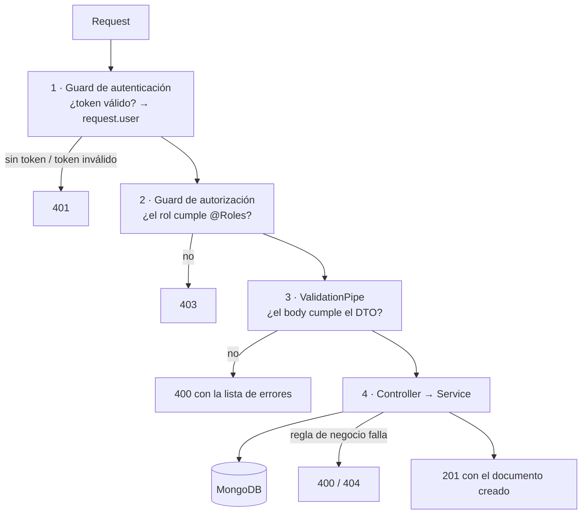

# Arquitectura

Cómo está organizado el proyecto, qué hace cada pieza y por qué se hizo así.

## Estructura de carpetas

```
src/
├── main.ts                     Arranque de la app
├── app.module.ts               Módulo raíz: configuración, Mongo y los módulos de negocio
├── app.controller.ts           GET /api → "Hello World!" (público, sirve para ver si la API responde)
│
├── conf/
│   ├── config.yaml             Valores de configuración (puerto, Mongo, colecciones, JWT)
│   └── config.ts               Lee el YAML y se lo entrega a ConfigModule
│
├── common/                     Código que usan todos los módulos
│   ├── dto/pagination.dto.ts           ?search, ?limit, ?offset
│   ├── pipes/parse-mongo-id.pipe.ts    Rechaza ids que no son de Mongo (400)
│   ├── transforms/to-boolean.transform.ts      "true"/"false" de la URL → boolean
│   ├── transforms/normalize-spaces.transform.ts "  a   b " → "a b"
│   └── utils/mongo.utils.ts            Búsqueda sin tildes, duplicados, paginación
│
├── auth/                       Usuarios, login y permisos → ver seguridad.md
│
├── iglesias/                   Directorio de iglesias
├── actividades/                Calendario de actividades
└── noticias/                   Noticias y comunicados
```

Cada módulo de negocio (`iglesias`, `actividades`, `noticias`) tiene la misma forma:

| Archivo | Qué hace |
|---|---|
| `*.module.ts` | Registra el modelo de Mongo, el controller y el servicio |
| `*.controller.ts` | Define las rutas y **quién puede usarlas** (decoradores de rol) |
| `*.service.ts` | La lógica: consultas a Mongo, reglas de negocio, errores |
| `entities/*.entity.ts` | El esquema de Mongo: qué campos se guardan y cómo |
| `dto/create-*.dto.ts` | Qué se acepta al crear (validación de entrada) |
| `dto/update-*.dto.ts` | Lo mismo pero todo opcional, más `isActive` |
| `dto/find-*.dto.ts` | Filtros del listado (`?distrito=`, `?desde=`...) |

**Por qué esta separación:** el controller solo decide *quién entra y qué recibe*; el servicio decide *qué pasa*. Así las reglas de negocio se pueden probar sin levantar un servidor (ver `iglesias.service.spec.ts`), y los permisos se leen de un vistazo en el controller.

## El camino de un request

Ejemplo: el panel crea una actividad con `POST /api/actividades`.



1. **Autenticación** (`@nestjs/authentication`, global): lee `Authorization: Bearer <token>`, verifica la firma y la expiración, y carga el usuario desde Mongo. Las rutas `@Public()` se saltan este paso.
2. **Autorización** (`@nestjs/authorization`, global): ejecuta la regla de `@Roles(...)`. Si la ruta no declara ninguna regla, **la rechaza**: así una ruta nueva nunca queda abierta por olvido.
3. **Validación** (`ValidationPipe` en `main.ts`): compara el body/query con el DTO. Con `whitelist` + `forbidNonWhitelisted`, cualquier campo que no esté en el DTO devuelve 400. Esto evita, por ejemplo, que alguien mande `"roles": ["ADMIN"]` al registrarse o `"autor"` en una noticia.
4. **Servicio**: aplica reglas que el DTO no puede ver solo (fechas coherentes, coordenadas en par, duplicados) y habla con Mongo.

## Arranque: `main.ts`

| Línea | Por qué |
|---|---|
| `setGlobalPrefix('api')` | Todas las rutas empiezan con `/api`, así se distinguen de las del front si comparten dominio |
| `enableCors({ origin: true })` | Permite que el sitio y el panel (en otro dominio/puerto) llamen a la API. **Abierto a todos: limitar antes de producción** |
| `ValidationPipe({ whitelist, forbidNonWhitelisted })` | Valida todo lo que entra y rechaza campos desconocidos |
| `configService.get('port')` | El puerto sale de `config.yaml` (3500) |

## Configuración: `conf/` y `.env`

Hay dos fuentes, y cada una tiene su propósito:

- **`config.yaml`**: valores que no son secretos y pueden ir en git (puerto, nombres de colecciones, URL de Mongo local). Se copia a `dist/` al compilar (lo indica `nest-cli.json`).
- **`.env`**: secretos y lo que cambia por ambiente (`JWT_SECRET`, `STAGE`, `URI`). No va en git.

La conexión a Mongo (`app.module.ts`) elige según `STAGE`:
- `dev` → `mongo.url` y `mongo.dbName` de `config.yaml`
- `production` → variables `URI` y `DBNAME`

Cada módulo toma el nombre de su colección de `config.yaml` (`collectionNameIglesia`, etc.). **Por qué:** permite apuntar a colecciones distintas sin tocar código (por ejemplo, para pruebas).

## Decisiones de diseño comunes

### Borrado lógico (`isActive`)
`DELETE` nunca borra el documento: lo marca `isActive: false`.
- **Por qué:** un borrado por error se deshace con `PATCH { "isActive": true }`, y se conserva el historial (una actividad pasada, una iglesia que cerró).
- Los visitantes nunca ven lo desactivado; el panel puede listarlo con `?isActive=false` para reactivarlo.

### Listados paginados
Todos los `GET` de lista responden igual:

```json
{ "total": 42, "limit": 20, "offset": 0, "data": [ ... ] }
```

- `limit` por defecto 20, máximo 100. **Por qué el máximo:** que nadie pueda pedir toda la base en un solo request.
- `total` permite al front calcular cuántas páginas hay.

### Búsqueda sin tildes ni mayúsculas
`?search=concepcion` encuentra "Iglesia de Concepción"; `?distrito=araucania` encuentra "Araucanía".
- **Cómo:** `mongo.utils.ts` quita las tildes de lo que escribe el usuario y convierte cada vocal en "esta vocal con o sin tilde" (`o` → `[oóòöô]`, `n` → `[nñ]`).
- **Por qué:** en Chile mucha gente escribe sin tildes en el teléfono; sin esto, la búsqueda del sitio parecería rota.
- También escapa los caracteres especiales: buscar `(central` o `.*` no rompe la consulta ni devuelve todo.

### PATCH que no pisa lo que no se envió
`definedOnly()` quita los campos `undefined` antes de guardar.
- **Por qué:** al validar, los campos del DTO que no venían en el body llegan como `undefined`. Sin este filtro, editar solo el título de una iglesia borraría su `isActive` (este bug existió y se corrigió).
- `null` sí se respeta: sirve para borrar un valor a propósito (por ejemplo `"inscripcion_url": null` quita el botón de inscripción).

### Duplicados → 400 en vez de 500
Los índices únicos de Mongo lanzan un error con código `11000`. `rethrowDuplicate()` lo convierte en un 400 con un mensaje claro ("ya existe una iglesia con ese nombre en ese distrito").

### Validación de ids
`ParseMongoIdPipe` en cada `/:id` responde 400 si el id no tiene el formato de Mongo, **antes** de consultar la base. Sin él, Mongo lanzaría un error de conversión que llegaría como 500.

### Espacios normalizados
`@NormalizeSpaces()` convierte `"  Iglesia   Central "` en `"Iglesia Central"` antes de validar.
- **Por qué:** el índice único compara texto exacto; sin esto, "Iglesia Central" e "Iglesia  Central" (dos espacios) serían iglesias distintas.

### Fechas en UTC
Mongo guarda las fechas en UTC y la API las devuelve así (`2026-10-31T22:00:00.000Z`).
- El panel debe enviarlas con zona horaria: `"2026-10-31T19:00:00-03:00"`.
- El front debe mostrarlas con `timeZone: 'America/Santiago'`; si no, la hora sale corrida.

## Módulos de negocio

### Iglesias
El directorio que muestra el sitio.
- **Campos:** `distrito`, `name`, `direccion`, `reuniones`, `encargado`, `email`, `lat`, `lng`.
- **Nombre único por distrito** (sin distinguir mayúsculas): puede haber una "Iglesia Central" en dos distritos distintos, pero no dos en el mismo.
- **Coordenadas en par:** `lat` y `lng` van juntas o ninguna. Un punto con una sola coordenada rompería el mapa. La regla se valida contra lo ya guardado, así un PATCH tampoco puede dejar media coordenada.
- **`GET /iglesias/distritos`:** lista de distritos con cuántas iglesias activas tiene cada uno, para el filtro del sitio. Va declarado antes que `/:id` porque si no, Nest tomaría "distritos" como un id.

### Actividades
El calendario del sitio. Los campos salen directamente del diseño de la tarjeta:

| En la tarjeta | Campo |
|---|---|
| "24 OCT" y la agrupación por mes | `fecha_inicio` |
| Etiqueta "Araucanía" / "Nacional" | `distrito` (vacío = `"Nacional"`) |
| 🕐 "19:00 h" o "Hasta el 25 de octubre" | `fecha_inicio` / `fecha_fin` |
| 📍 "Temuco" / "En línea" | `lugar` |
| Botón "Inscribirme" (solo en algunas) | `inscripcion_url` |

- **`fecha_fin` no puede ser anterior a `fecha_inicio`**, tampoco combinando lo guardado con un PATCH.
- **Filtro `?desde=`** devuelve también las actividades que empezaron antes pero siguen en curso (un retiro de dos días aparece el segundo día).
- Vienen **ordenadas por fecha ascendente**: el front las agrupa por mes tal como llegan.

### Noticias
Noticias y comunicados del sitio.
- **`categoria` es una lista fija** (`Misiones`, `Comunicado oficial`, `Oración`, `Historia`), definida en `noticias/interfaces/categoria.enum.ts`. **Por qué no texto libre:** el front elige el ícono de la tarjeta según la categoría; un valor inesperado dejaría la tarjeta sin ícono. Para agregar una, se suma al enum.
- **Borradores:** se crean con `publicado: false`. La primera vez que se publican se guarda `fecha_publicacion`. Esa fecha también se puede enviar a mano, para cargar noticias antiguas con su fecha original.
- **El autor sale del token**, nunca del body: nadie puede publicar a nombre de otro. En la respuesta solo va su nombre, no su correo.
- **El listado no trae `contenido`** (el texto completo): las tarjetas solo usan `resumen`, y así la respuesta pesa mucho menos. El detalle (`/:id`) sí lo trae.

## Tests

```bash
yarn test
```

- `common/utils/mongo.utils.spec.ts`: búsqueda sin tildes, escape de caracteres especiales, `definedOnly`.
- `iglesias/iglesias.service.spec.ts`: visitante vs. panel, coordenadas, duplicados, que un PATCH no pise campos. Usa un modelo de Mongo simulado, no necesita base de datos.
- `iglesias/iglesias.controller.spec.ts`: que cada rol reciba la vista correcta.

Los specs de `auth` y `app` vienen del generador de Nest y fallan porque no tienen sus dependencias simuladas.
